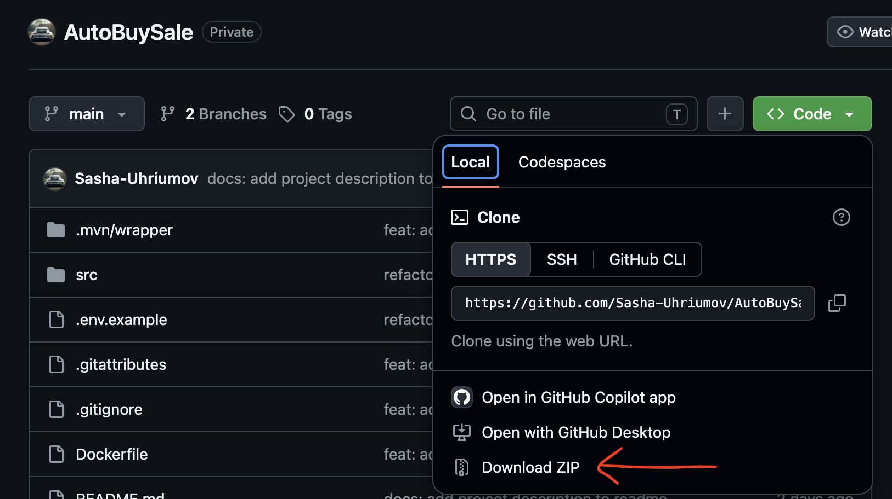
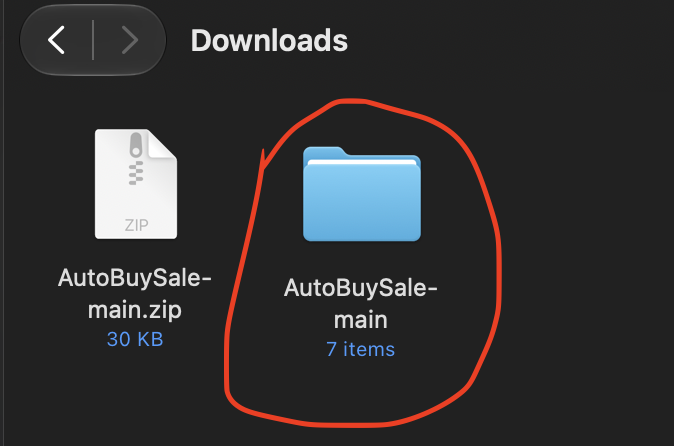
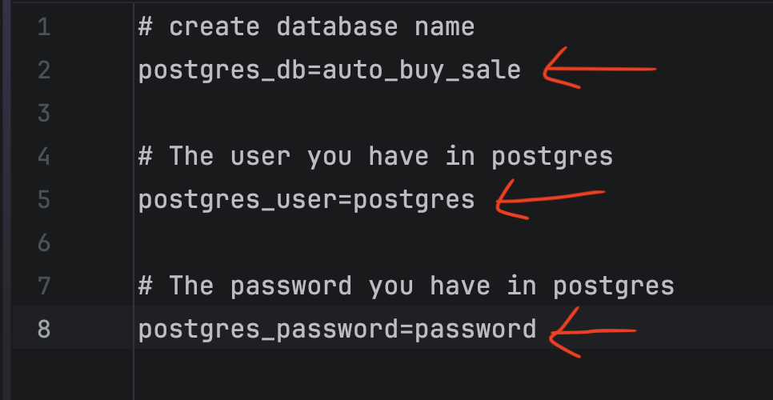
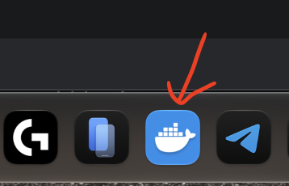
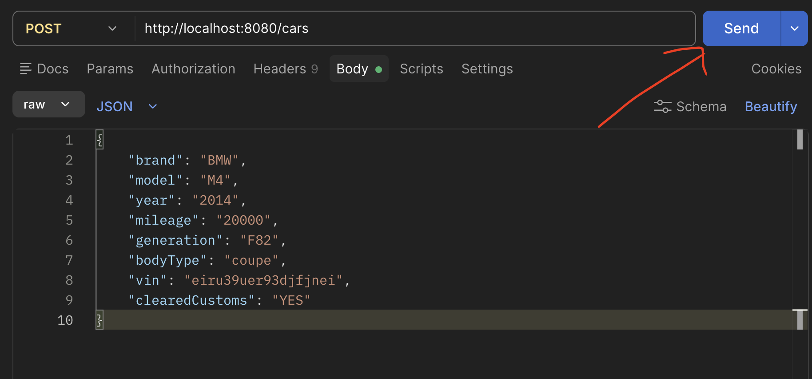
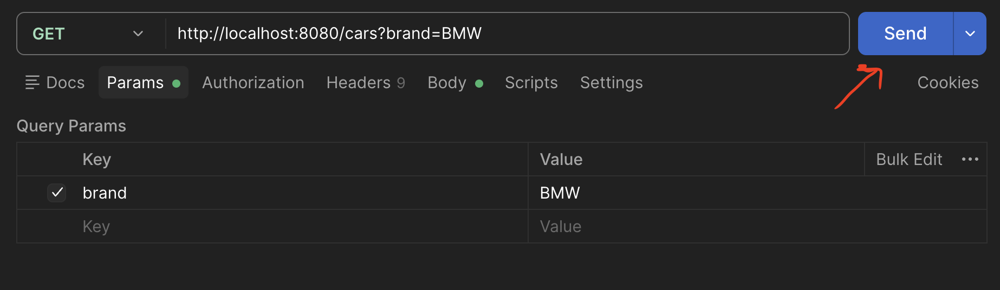
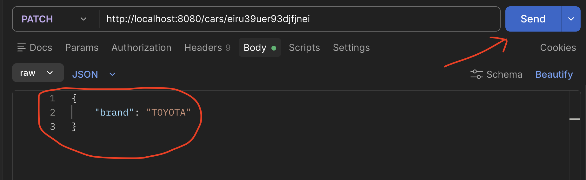
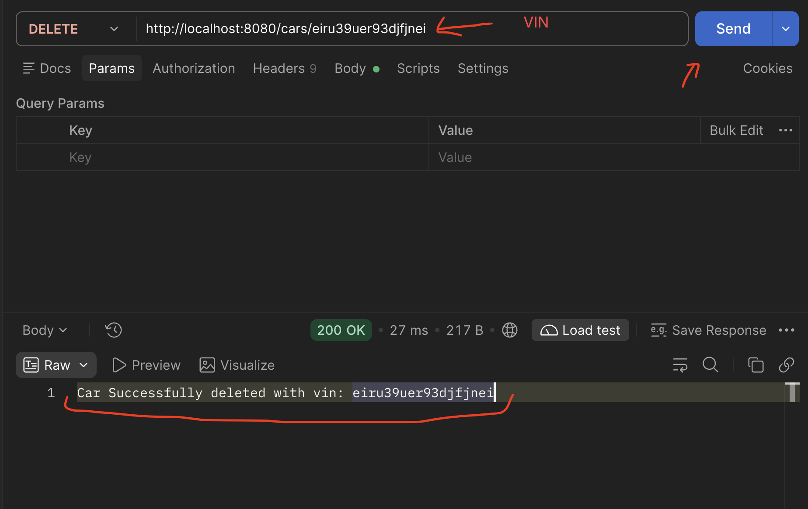

# AutoBuySale

---

### A backend application for upload and search cars written in Java, Spring Boot, and also uses PostgreSQL for data storage.

---

### Installation ot the project 
> 1. You need to download the project from GitHub. 
> 
> 2. After downloading the ZIP file, you need to unzip it a folder will appear next to it.
> 
> 3. open this folder through the development environment

---

### Preparing to launch the program

> 1. You need Docker
> 2. You should rename the .env.example file to .env
> 3. You need to fill in the fields with your own information, as everything is written here as an example.
> 

---

### How to start app
> 1. Run docker application  
> 
> 2. In the terminal, write this command
> ```bash
> docker compose up --build
> ```
> 3. To stop the program, you need to write this command
> ```bash
> docker compose stop
 

---

### How to use the program
> here is the url
> ```bash
> http://localhost:8080/cars

> Create a car:
> 

> Car search:
> 
> You can search for a car by:  
> brand  
> model  
> year  
> mileage  
> generation  
> bodyType  
> vin  
> clearedCustoms  

> Update vehicle data:
> 

> Delete a car by VIN:
> 